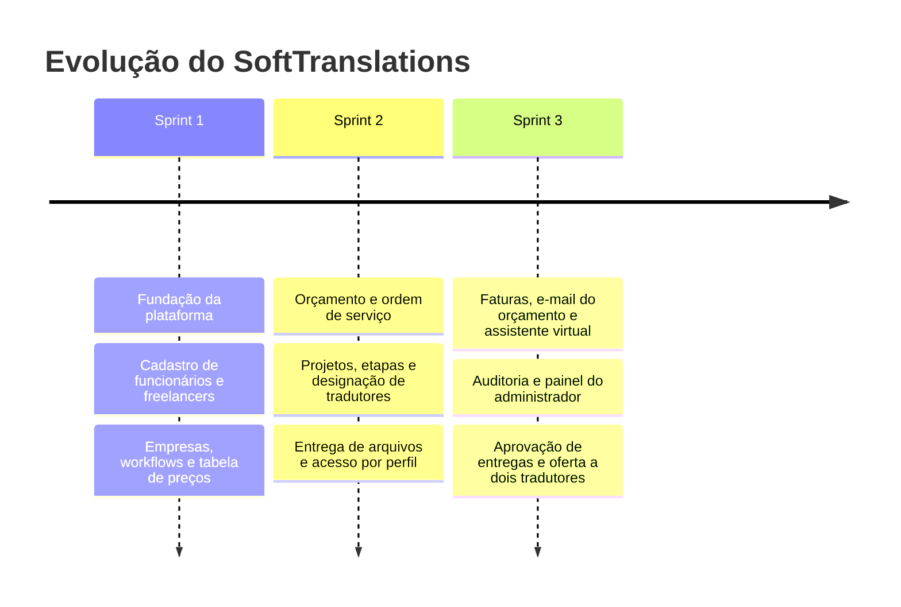

# SoftTranslations

## Gerenciamento de serviços de tradução

O SoftTranslations é uma aplicação desenvolvida pela equipe **SoftworksBR**
em parceria com a **Aliança Traduções**, no projeto de Aprendizagem por
Projetos Integrados (API) da Fatec São José dos Campos, 2026-2. O produto
organiza as solicitações de tradução e o fluxo de trabalho interno de uma
agência de tradução. O projeto inclui um frontend responsivo em Expo/React
Native (web e dispositivos móveis) e uma API FastAPI.

---
## 📖 Sumário

- [Sobre o Projeto](#about)
- [Descrição do Desafio](#challenge)
- [Recursos disponíveis](#available-features)
- [Backlog do Produto](#backlog)
- [Cronograma de evolução](#timeline)
- [Sprints](#sprints)
- [Tecnologias Utilizadas](#tecnologies)
- [Estrutura do Projeto](#structure)
- [Como executar, usar e testar](#run)
- [Manuais e documentação](#documents)
- [Autores](#authors)

---

## <span id="about">Sobre o Projeto</span>

O sistema organiza solicitações públicas, propostas de orçamento e projetos
com etapas de trabalho. O acesso interno é separado por perfis de
administrador, atendimento, gestor de projetos e tradutor freelancer.

## <span id="challenge">Descrição do Desafio</span>

**Parceiro:** Aliança Traduções. **Desafio:** desenvolvimento da base de um
sistema de gestão da tradução (TBMS, *Translation Business Management System*)
para uma agência de tradução.

**A dor do parceiro:** um TBMS é o sistema principal, usado pela maioria dos
colaboradores e freelancers de uma agência. Existem poucos no mercado e menos
ainda nacionais; as opções mais completas são muito caras, e por isso as
agências costumam desenvolver os próprios sistemas. A Aliança Traduções quer um
sistema completo, com uma base que comporte todas as funcionalidades desejadas,
tendo a Plunet, um dos principais TBMS do mercado, como referência.

**Requisitos não funcionais do desafio:** Manual de Instalação e Manual do
Usuário (obrigatórios, no Git); documentação da API; modelagem do banco de
dados; aplicação para plataforma móvel em TypeScript, React e React Native,
com banco relacional e NoSQL acessados por ORM.

## <span id="available-features">Recursos disponíveis</span>

- Formulário público para envio de solicitação de tradução, com vários idiomas
  de destino e anexos, e assistente virtual (chat) para tirar dúvidas.
- Consulta de solicitações, com filtros, e criação, edição e envio do
  orçamento por e-mail (PDF) pelo atendimento; o cliente aprova ou recusa pelo
  link recebido.
- Fatura de venda ao cliente e fatura de pagamento ao tradutor, em PDF e por
  e-mail.
- Criação de projeto a partir de orçamento aprovado e associação a trilhas de
  workflow; cadastro de etapas reutilizáveis e trilhas.
- Designação de tradutores por etapa, com filtro por idiomas, aceite ou
  recusa do tradutor e oferta da etapa a até dois tradutores (o primeiro que
  aceitar fica com ela).
- Entrega de arquivos pelo tradutor e aprovação ou reprovação da entrega pelo
  gestor.
- Painel do administrador com indicadores, e gerenciamento de contas internas.
- Trilha de auditoria das ações (MongoDB).

O [Manual do Usuário](docs/user_manual.md) registra os fluxos de cada perfil e
as limitações conhecidas; o [Manual de Instalação](docs/instalation_manual.md)
descreve como executar o projeto.

---

# 📋 <span id="backlog">Backlog do Produto</span>

> **Estimativa:** esforço relativo em story points (sequência de Fibonacci), definido pelo Product Owner a partir da complexidade de cada história e das estimativas de horas das tarefas de cada Sprint.

O backlog abaixo é o planejamento do produto, não uma lista de recursos
garantidamente implementados. Consulte a seção [Recursos disponíveis](#available-features)
e os manuais para entender o que pode ser utilizado hoje.

| Rank | Prioridade | User Story | Estimativa | Sprint |
|---:|---|---|---:|---|
| 1 | Alta | Como administrador, quero cadastrar os funcionários internos, informando seus dados e o perfil de acesso, para organizar o acesso da equipe ao sistema. | 5 | Sprint 1 |
| 2 | Alta | Como gestor de projeto, quero pré-cadastrar um freelancer com seus dados básicos, para convidá-lo a completar o cadastro e se juntar à equipe de prestadores. | 5 | Sprint 1 |
| 3 | Alta | Como freelancer, quero completar meu cadastro informando tipo (tradutor/revisor/formatador/intérprete), habilidades, idiomas e documentos comprobatórios, para finalizar minha entrada na base de prestadores. | 8 | Sprint 1 |
| 4 | Alta | Como freelancer, quero que meu cadastro seja ativado automaticamente quando eu completar minhas informações, para acessar o sistema sem esperar uma aprovação manual. | 3 | Sprint 1 |
| 5 | Alta | Como atendimento, quero cadastrar empresas clientes com seus departamentos e contatos, para organizar quem solicita os serviços. | 5 | Sprint 1 |
| 6 | Alta | Como gestor de projeto, quero cadastrar e editar modelos de workflow reutilizáveis, com suas etapas e o tipo de freelancer necessário em cada uma, para agilizar a montagem de novos projetos. | 8 | Sprint 1 |
| 7 | Alta | Como administrador, quero cadastrar tabelas de preço por par de idioma e itens adicionais, para uso na montagem de orçamentos. | 5 | Sprint 1 |
| 8 | Alta | Como atendimento, quero criar um orçamento a partir de uma Requisição ou solicitação do cliente, para formalizar o pedido de serviço. | 8 | Sprint 2 |
| 9 | Alta | Como atendimento, quero registrar a aprovação do orçamento pelo cliente, para gerar a ordem de serviço. | 5 | Sprint 2 |
| 10 | Alta | Como gestor de projeto, quero definir as etapas de uma ordem de serviço a partir de um modelo de workflow, para estruturar o projeto. | 8 | Sprint 2 |
| 11 | Alta | Como gestor de projeto, quero selecionar ou atribuir freelancers para cada etapa, escolhendo entre atribuição automática (melhor posicionado ou primeiro a aceitar) ou manual (requisitar disponibilidade ou atribuição direta), para adequar o método a cada caso. | 13 | Sprint 2 |
| 12 | Alta | Como freelancer, quero visualizar e aceitar os trabalhos disponibilizados a mim, para saber o que preciso executar. | 5 | Sprint 2 |
| 13 | Média | Como freelancer, quero entregar o arquivo referente à minha etapa, para concluir minha parte do trabalho. | 5 | Sprint 2 |
| 14 | Média | Como gestor de projeto, quero que o sistema encaminhe automaticamente o trabalho para o freelancer da próxima etapa assim que uma etapa for entregue, para manter o fluxo sem intervenção manual. | 8 | Sprint 2 |
| 15 | Média | Como gestor de projeto, quero verificar todas as etapas concluídas antes de enviar o resultado final ao cliente, para garantir que nada ficou pendente. | 3 | Sprint 2 |
| 16 | Média | Como freelancer, quero ter acesso apenas à etapa em que fui alocado, para preservar a confidencialidade das demais partes do projeto. | 3 | Sprint 2 |
| 17 | Média | Como atendimento, quero ajustar manualmente o valor final de um orçamento sem alterar a tabela de preço padrão, para atender casos específicos. | 3 | Sprint 2 |
| 18 | Média | Como gestor de projeto, quero visualizar a lista de ordens de serviço sem freelancer atribuído e já atribuídas, para acompanhar a distribuição do trabalho. | 3 | Sprint 2 |
| 19 | Média | Como cliente, quero um auxílio de bots para tirar dúvidas pontuais, para obter respostas rápidas sobre serviços, idiomas e prazos sem depender do horário de atendimento. | 13 | Sprint 3 |
| 20 | Média | Como financeiro, quero criar a fatura de compra referente ao pagamento de um freelancer, para formalizar o valor devido a ele. | 8 | Sprint 3 |
| 21 | Média | Como financeiro, quero criar a fatura de venda de um serviço finalizado, para ter um documento-guia para o sistema externo de nota fiscal. | 8 | Sprint 3 |
| 22 | Média | Como gestor, quero controlar as alterações dos projetos, para garantir a rastreabilidade das ações realizadas. | 13 | Sprint 3 |
| 23 | Média | Como atendente, quero enviar um email referente ao orçamento, para que o cliente tenha a confirmação do início do projeto. | 8 | Sprint 3 |
| 24 | Baixa | Como administrador, quero consultar requisições, orçamentos, ordens de serviço e financeiro, para acompanhar o desempenho do negócio. | 5 | Sprint 3 |
--- 

## 📅 <span id="sprint">Programação por Sprint </span>

### 🟢 Sprint 1 - Fundação da Plataforma e Solicitações

**Objetivo:** criar a estrutura base do sistema (páginas, conexões cruds básicos) 

### 📈 Backlog da Sprint 1

| Rank | Prioridade | User Story | Estimativa | Sprint |
|---:|---|---|---:|---|
| 1 | Alta | Como administrador, quero cadastrar os funcionários internos, informando seus dados e o perfil de acesso, para organizar o acesso da equipe ao sistema. | 5 | Sprint 1 |
| 2 | Alta | Como gestor de projeto, quero pré-cadastrar um freelancer com seus dados básicos, para convidá-lo a completar o cadastro e se juntar à equipe de prestadores. | 5 | Sprint 1 |
| 3 | Alta | Como freelancer, quero completar meu cadastro informando tipo (tradutor/revisor/formatador/intérprete), habilidades, idiomas e documentos comprobatórios, para finalizar minha entrada na base de prestadores. | 8 | Sprint 1 |
| 4 | Alta | Como freelancer, quero que meu cadastro seja ativado automaticamente quando eu completar minhas informações, para acessar o sistema sem esperar uma aprovação manual. | 3 | Sprint 1 |
| 5 | Alta | Como atendimento, quero cadastrar empresas clientes com seus departamentos e contatos, para organizar quem solicita os serviços. | 5 | Sprint 1 |
| 6 | Alta | Como gestor de projeto, quero cadastrar e editar modelos de workflow reutilizáveis, com suas etapas e o tipo de freelancer necessário em cada uma, para agilizar a montagem de novos projetos. | 8 | Sprint 1 |
| 7 | Alta | Como administrador, quero cadastrar tabelas de preço por par de idioma e itens adicionais, para uso na montagem de orçamentos. | 5 | Sprint 1 |
## 🚀 MVP(Mínimo Produto Viável) Sprint 1:

- [1] CRUD básico de Administradores, Gestores, Atendente por parte do Administrador.
- [2] Pré-cadastro do Freelancer por parte do Gestor.
- [3] Conclusão de cadastro por parte do Freelancer.
- [3] Cadastro de Workflow por parte do Gestor.

---

### 📈 Backlog da Sprint 2

O backlog completo da Sprint, com origem, confiança e situação de cada história, está em [Backlog_Sprint2.md](docs/sprints/sprint-2/Backlog_Sprint2.md); o detalhamento (DoR) e a DoD ficam em [DoR_Sprint2.md](docs/sprints/sprint-2/DoR_Sprint2.md) e [DoD_Testes_Sprint2.md](docs/sprints/sprint-2/DoD_Testes_Sprint2.md). Ele dá continuidade às histórias da Sprint 1 (S1-1 a S1-7), as configurações e cadastros pedidos pelo cliente e as histórias do Backlog de Produto de rank 8 a 19 (coluna *Origem* do documento).

| Rank | Faixa | ID | User Story | Estimativa |
|---:|---|---|---|---:|
| 1 | Meta | S2-01 | Como administrador, quero cadastrar e editar os idiomas com que a Aliança trabalha, para usá-los nas tabelas de preço, nas requisições e no cadastro dos freelancers. | 3 |
| 2 | Meta | S2-02 | Como administrador, quero cadastrar e editar os tipos de serviço oferecidos (ex.: tradução, revisão, DTP), para usá-los em requisições, orçamentos e preços. | 3 |
| 3 | Meta | S2-03 | Como administrador, quero cadastrar a tabela de preços por serviço e par de idiomas, para calcular o valor dos orçamentos. | 5 |
| 4 | Meta | S2-04 | Como administrador, quero cadastrar usuários internos informando nome, sobrenome, e-mail e perfil, para organizar o acesso da equipe. | 5 |
| 5 | Meta | S2-05 | Como atendimento, quero cadastrar clientes como Empresa (pessoa jurídica) ou Pessoa (pessoa física), com seus contatos, para organizar quem solicita os serviços. | 5 |
| 6 | Meta | S2-06 | Como gestor de projeto, quero pré-cadastrar um freelancer informando nome, sobrenome e e-mail, para que ele complete o próprio cadastro. | 5 |
| 7 | Meta | S2-07 | Como freelancer, quero completar meu cadastro informando meu perfil, idiomas de partida, chegada e nativo e os tipos de serviço que presto, para finalizar minha entrada na base de prestadores. | 8 |
| 8 | Meta | S2-08 | Como gestor de projeto, quero que o cadastro do freelancer seja ativado automaticamente quando ele completar as informações, para liberar o acesso dele ao trabalho. | 3 |
| 9 | Meta | S2-09 | Como atendimento, quero registrar uma requisição de orçamento recebida do cliente, para dar início ao processo de orçamento. | 3 |
| 10 | Meta | S2-10 | Como atendimento, quero analisar uma requisição e aprová-la para que ela se torne um orçamento, informando prazo e observações, para formalizar o pedido de serviço. | 8 |
| 11 | Meta | S2-11 | Como atendimento, quero ajustar manualmente o valor final de um orçamento sem alterar a tabela de preço padrão, para atender casos específicos. | 3 |
| 12 | Meta | S2-12 | Como atendimento, quero registrar a aprovação do orçamento pelo cliente, para gerar a ordem de serviço. | 5 |
| 13 | Meta | S2-13 | Como gestor de projeto, quero ver o orçamento aprovado e montar o projeto a partir dele, escolhendo um modelo de workflow para definir as etapas, para estruturar o trabalho. | 8 |
| 14 | Meta | S2-14 | Como gestor de projeto, quero atribuir freelancers às etapas — diretamente ou solicitando disponibilidade a freelancers selecionados —, para distribuir o trabalho. | 13 |
| 15 | Meta | S2-15 | Como freelancer, quero visualizar os trabalhos disponibilizados a mim e aceitá-los, para saber o que preciso executar. | 5 |
| 16 | Planejada | S2-16 | Como freelancer, quero ter acesso apenas à etapa em que fui alocado, para preservar a confidencialidade das demais partes do projeto. | 3 |
| 17 | Planejada | S2-17 | Como freelancer, quero entregar o arquivo referente à minha etapa, para concluir minha parte do trabalho. | 5 |
| 18 | Planejada | S2-18 | Como gestor de projeto, quero que o trabalho siga automaticamente para a próxima etapa assim que uma etapa for entregue, para manter o fluxo sem intervenção manual. | 8 |
| 19 | Planejada | S2-19 | Como gestor de projeto, quero visualizar a lista de ordens de serviço sem freelancer atribuído e já atribuídas, para acompanhar a distribuição do trabalho. | 3 |
| 20 | Planejada | S2-20 | Como gestor de projeto, quero verificar todas as etapas concluídas e repassar o projeto ao Atendimento, para garantir que nada ficou pendente antes da entrega ao cliente. | 3 |
| 21 | Planejada | S2-21 | Como administrador, quero que cada perfil enxergue e acesse somente os menus e funcionalidades do seu perfil, para proteger as informações do negócio. | 3 |
| 22 | Complementar | S2-22 | Como administrador, quero cadastrar as áreas de domínio e os softwares usados pelos freelancers, para que eles os selecionem no próprio cadastro. | 5 |
| 23 | Complementar | S2-23 | Como freelancer, quero informar minhas áreas de domínio e os softwares que utilizo, para completar meu perfil profissional. | 5 |
| 24 | Complementar | S2-24 | Como freelancer, quero informar meus horários de trabalho e minhas ausências, para que só me ofereçam trabalho quando estou disponível. | 5 |
| 25 | Complementar | S2-25 | Como freelancer, quero enviar o termo de confidencialidade assinado e meus documentos e certificações, para concluir minha habilitação. | 5 |
| 26 | Complementar | S2-26 | Como freelancer, quero informar meus dados de pagamento, para que a Aliança possa me pagar pelos serviços. | 3 |
| 27 | Complementar | S2-27 | Como colaborador interno, quero incluir minha data de nascimento, foto e telefone no meu perfil, para completar meus dados. | 2 |
| 28 | Complementar | S2-28 | Como administrador, quero criar e editar grupos de permissão com controles por módulo e ação, para adaptar os perfis internos à estrutura real da empresa. | 13 |

**Total estimado:** 145 story points. A *Meta* (rank 1 a 15) é a entrega obrigatória; a faixa *Planejada* (16 a 21) e a *Complementar* (22 a 28) entram em ordem de prioridade, de cima para baixo.

## 🚀 MVP (Mínimo Produto Viável) — Sprint 2

1. **Orçamento e ordem de serviço (itens 8, 9 e 17):** o atendimento cria um orçamento a partir de uma requisição, informa prazo e observações, ajusta o valor final sem alterar a tabela de preços e registra a aprovação do cliente. A aprovação gera uma ordem de serviço vinculada à requisição e ao orçamento.
2. **Preparação e distribuição do projeto (itens 10, 11 e 18):** o gestor cria o projeto da ordem de serviço usando um workflow existente, acompanha ordens com e sem freelancer atribuído e distribui cada etapa. No MVP, a atribuição pode ser direta pelo gestor ou por solicitação de disponibilidade a candidatos selecionados, com encaminhamento ao primeiro candidato que aceitar. A seleção automática por “melhor posicionado” fica para uma evolução posterior.
3. **Execução das etapas (itens 12, 13 e 16):** o freelancer consulta os trabalhos disponibilizados, aceita uma solicitação de disponibilidade e visualiza somente as etapas atribuídas a si. Em cada etapa, pode enviar o arquivo de entrega e acompanhar sua situação.
4. **Progressão e encerramento (itens 14 e 15):** após a entrega de uma etapa, o sistema encaminha o trabalho à próxima etapa definida no workflow. O gestor consegue conferir o progresso e só pode marcar o projeto como concluído quando todas as etapas tiverem sido entregues.
5. **Acesso por perfil (requisito transversal, versão mínima):** o MVP mantém o controle de acesso pelos perfis existentes — atendimento, gestor, administrador e freelancer — e garante que cada perfil opere somente nas áreas autorizadas. A criação de grupos configuráveis com permissões por módulo e ação fica para uma evolução posterior.

---

### 📈 Backlog da Sprint 3

| Rank | Prioridade | User Story | Estimativa | Sprint |
|---:|---|---|---:|---|
| 19 | Média | Como cliente, quero um auxílio de bots para tirar dúvidas pontuais, para obter respostas rápidas sobre serviços, idiomas e prazos sem depender do horário de atendimento. | 13 | Sprint 3 |
| 20 | Média | Como financeiro, quero criar a fatura de compra referente ao pagamento de um freelancer, para formalizar o valor devido a ele. | 8 | Sprint 3 |
| 21 | Média | Como financeiro, quero criar a fatura de venda de um serviço finalizado, para ter um documento-guia para o sistema externo de nota fiscal. | 8 | Sprint 3 |
| 22 | Média | Como gestor, quero controlar as alterações dos projetos, para garantir a rastreabilidade das ações realizadas. | 13 | Sprint 3 |
| 23 | Média | Como atendente, quero enviar um email referente ao orçamento, para que o cliente tenha a confirmação do início do projeto. | 8 | Sprint 3 |
| 24 | Baixa | Como administrador, quero consultar requisições, orçamentos, ordens de serviço e financeiro, para acompanhar o desempenho do negócio. | 5 | Sprint 3 |
## 🚀 MVP (Mínimo Produto Viável) — Sprint 3

1. **Financeiro (itens 20 e 21):** fatura de pagamento ao tradutor e fatura de
   venda ao cliente, em PDF e enviadas por e-mail.
2. **Comunicação com o cliente (itens 19 e 23):** envio do orçamento por
   e-mail com botões para aprovar ou recusar, e assistente virtual na página
   pública para dúvidas pontuais.
3. **Rastreabilidade (item 22):** trilha de auditoria das ações sobre
   solicitações, orçamentos, projetos e etapas.
4. **Acompanhamento (item 24):** painel do administrador com indicadores de
   requisições, orçamentos, projetos e financeiro.
5. **Refinamentos da operação:** aprovação ou reprovação da entrega pelo gestor,
   filtro de tradutores por idioma, edição do orçamento com anexos e oferta da
   etapa a até dois tradutores.

Detalhes e situação de cada item: [Sprint 3](docs/sprints/sprint-3.md).

---

## 📅 <span id="timeline">Cronograma de evolução</span>



## 🏃 <span id="sprints">Sprints</span>

| Sprint | Período | Objetivo | Documentação |
|---|---|---|---|
| 1 | 07/09/2026 a 27/09/2026 | Fundação da plataforma e solicitações | [Documentação da Sprint 1](docs/sprints/sprint-1.md) |
| 2 | 05/10/2026 a 25/10/2026 | Configurações, cadastros, orçamento, projetos e distribuição do trabalho | [Backlog e MVP](#-backlog-da-sprint-2); [Backlog detalhado](docs/sprints/sprint-2/Backlog_Sprint2.md), [DoR](docs/sprints/sprint-2/DoR_Sprint2.md) e [DoD e testes](docs/sprints/sprint-2/DoD_Testes_Sprint2.md) |
| 3 | 02/11/2026 a 22/11/2026 | Financeiro, comunicação, rastreabilidade e painel | [Documentação da Sprint 3](docs/sprints/sprint-3.md) |

---|---|---|---|---|
| 1 | _a preencher_ | Fundação da plataforma e solicitações | [Backlog e MVP](#-backlog-da-sprint-1) | _a preencher_ |
| 2 | _a preencher_ | Orçamento, projetos e distribuição do trabalho | [Backlog e MVP](#-backlog-da-sprint-2) | _a preencher_ |
| 3 | _a preencher_ | Financeiro, comunicação, rastreabilidade e painel | [Documentação da Sprint 3](docs/sprints/sprint-3.md) | _a preencher_ |

---

## 💻 <span id="tecnologies">Tecnologias Utilizadas</span>
<h4 align="center">
  <a href="https://www.typescriptlang.org/"></a>
  <a href="https://reactnative.dev/"></a>
  <a href="https://expo.dev/"></a>
  <a href="https://www.python.org/"></a>
  <a href="https://fastapi.tiangolo.com/"></a>
  <a href="https://www.postgresql.org/"></a>
  <a href="https://www.mongodb.com/"></a>
  <a href="https://git-scm.com/"></a>
  <a href="https://github.com/"></a>
</h4>

| Camada | Tecnologias |
| --- | --- |
| Frontend (web e móvel) | TypeScript, React, React Native, Expo e Expo Router |
| Backend | Python 3.13, FastAPI, SQLAlchemy 2 (ORM assíncrono), Alembic, Pydantic |
| Banco relacional | PostgreSQL |
| Banco NoSQL | MongoDB (auditoria e logs técnicos) |
| Assistente virtual | Google Gemini, por meio do Google ADK |
| Qualidade | pytest, ruff, ESLint e checagem de tipos do TypeScript |
| Versionamento | Git e GitHub, com Pull Requests e revisão de código |

---

## 🗂️ <span id="structure">Estrutura do Projeto</span>

```text
SoftTraslations/
├── backend/                 API FastAPI
│   ├── alembic/versions/    migrações do banco relacional
│   ├── src/
│   │   ├── routes/          endpoints
│   │   ├── controllers/     entrada e saída das rotas
│   │   ├── services/        regras de negócio
│   │   ├── repositories/    acesso ao banco
│   │   ├── models/          tabelas (SQLAlchemy)
│   │   ├── schemas/         validação e respostas (Pydantic)
│   │   └── agents/          assistente virtual
│   └── tests/               testes automatizados
├── Front-Geral/             aplicativo Expo / React Native
│   ├── app/                 telas por perfil (atendente, gestor, tradutor, admin)
│   ├── components/          componentes reutilizáveis
│   └── services/            chamadas à API
└── docs/                    documentação do projeto
```

---

## ▶️ <span id="run">Como executar, usar e testar</span>

O passo a passo completo, com Windows e Linux, está no
[Manual de Instalação](docs/instalation_manual.md). Em resumo, com PostgreSQL
em execução e um banco `soft_translations_db` criado:

```bash
# Backend (porta 8000)
cd backend
uv sync
cp .env.example .env        # preencha DATABASE_URL, SECRET_KEY e o admin inicial
uv run alembic upgrade head
uv run uvicorn src.main:app --reload

# Frontend (em outro terminal)
cd Front-Geral
npm install
npm run web                 # ou: npx expo start --lan, para o Expo Go
```

- **Usar:** entre com a conta de administrador criada na primeira
  inicialização e siga o [Manual do Usuário](docs/user_manual.md). A
  documentação interativa da API fica em `http://localhost:8000/docs`.
- **Testar o backend:** `cd backend && uv run pytest` e `uv run ruff check .`
- **Testar o frontend:** `cd Front-Geral && npm run lint && npx tsc --noEmit`

---

## 📚 <span id="documents">Manuais e Documentação</span>

Pasta de documentação: [`docs/`](docs/).

- [Manual de Instalação](docs/instalation_manual.md)
- [Manual do Usuário](docs/user_manual.md)
- [Modelagem do Banco de Dados](docs/modelagem_banco.md)
- [Documentação do backend e da API](backend/README.md)
- [Notas técnicas do fluxo solicitação–orçamento–projeto](docs/FLUXO_ORCAMENTO_E_PROJETOS.md)
- [Checklists de DoR e DoD](docs/dor_dod.md)
- [Estratégia de Branch](docs/estrategia_branch.md)
- [Padrão de Mensagens de Commit](docs/padrao_commits.md)
- Documentação por Sprint: [Sprint 1](docs/sprints/sprint-1.md),
  [Sprint 2](docs/sprints/sprint-2/Backlog_Sprint2.md) e
  [Sprint 3](docs/sprints/sprint-3.md).

---

## 👥 <span id="authors">Autores</span>

<div align="center">
  <table>
    <tr>
      <th>Foto</th>
      <th>Membro</th>
      <th>Função</th>
      <th>Github</th>
      <th>Linkedin</th>
    </tr>
    <tr>
      <td></td>
      <td>Igor Mateus de Andrade</td>
      <td>Scrum Master</td>
      <td><a href="https://github.com/IgorAndrade2024/"></a></td>
      <td><a href="https://www.linkedin.com/in/igor-andrade-b3b434327"></a></td>
    </tr>
        <tr>
      <td></td>
      <td>Mariana Lins</td>
      <td>Product Owner</td>
      <td><a href="https://github.com/mariana-lins/"></a></td>
      <td><a href="https://www.linkedin.com/in/mariana-lins8/"></a></td>
    </tr>
    <tr>
      <td></td>
      <td>Guilherme Henrique</td>
      <td>Desenvolvedor</td>
      <td><a href="https://github.com/guiih0412"></a></td>
      <td><a href="https://www.linkedin.com/in/guilherme-henrique-36b3a0220/"></a></td>
    </tr>
    <tr>
      <td></td>
      <td>Tiago Bertolini</td>
      <td>Desenvolvedor</td>
      <td><a href="https://github.com/HelionLight"></a></td>
      <td><a href="https://www.linkedin.com/in/tiago-bortolini-772b162b6/"></a></td>
    </tr>
    <tr>
      <td></td>
      <td>Fábio Nawa</td>
      <td>Desenvolvedor</td>
      <td><a href="https://github.com/FabioNawa"></a></td>
      <td><a href="https://www.linkedin.com/in/f%C3%A1biohnawa/"></a></td>
    </tr>
  </table>
</div>
