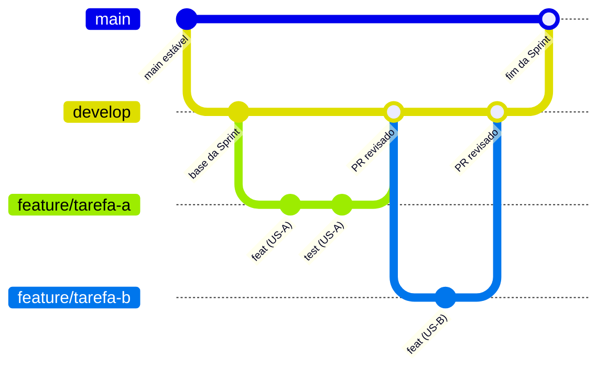

# Estratégia de Branch

O SoftTranslations usa uma variação do **GitHub Flow com uma branch de
integração** (`develop`). Este documento descreve a estratégia e justifica a
escolha.

## Branches

| Branch | Função | Quem escreve nela |
| --- | --- | --- |
| `main` | Versão estável e entregue. Só recebe o que já foi integrado e validado na `develop`, no fechamento de cada Sprint. | Ninguém commita direto; só por Pull Request. |
| `develop` | Integração contínua das tarefas da Sprint. É a base de todas as branches de trabalho. | Ninguém commita direto; só por Pull Request com revisão. |
| `feature/<descrição>` | Uma funcionalidade (User Story ou melhoria). Exemplo: `feature/gestor-convida-segundo-tradutor`. | Quem desenvolve a tarefa. |
| `fix/<descrição>` | Correção de defeito ou ajuste vindo de revisão. Exemplo: `fix/filtro-review`. | Quem corrige. |
| `docs/<descrição>` | Alteração só de documentação. Exemplo: `docs/modelagem-banco`. | Quem documenta. |

## Fluxo de trabalho

1. A branch de trabalho nasce da `develop` atualizada, com o nome no padrão
   acima.
2. O desenvolvedor faz commits pequenos, seguindo o
   [Padrão de Mensagens de Commit](./padrao_commits.md).
3. Ao terminar, abre um **Pull Request** para a `develop`, com título no mesmo
   padrão e descrição que resume o que foi feito, as regras de negócio e os
   cenários de teste.
4. O PR passa por **revisão de outro membro da equipe** e por uma revisão
   automática de código (GitHub Copilot). Pontos válidos viram novos commits
   na mesma branch. Ninguém aprova o próprio PR.
5. Com a aprovação, o PR é mesclado na `develop`. A `develop` é protegida: não
   aceita commit direto nem merge sem PR aprovado.
6. No fechamento da Sprint, depois da validação da equipe e da demonstração
   (Review), a `develop` é levada à `main` por Pull Request.

## Justificativa

- **Equipe de cinco pessoas trabalhando em paralelo:** cada tarefa fica
  isolada em sua branch, e uma tarefa incompleta não quebra o trabalho dos
  outros.
- **`develop` como área de integração:** concentra os PRs da Sprint e permite
  testar o conjunto antes de chegar à `main`. A `main` sempre representa algo
  que a equipe aceitou como entrega, o que evita perder código por commits
  diretos.
- **Pull Request obrigatório:** é o ponto de *code review* exigido pela
  Definition of Done e deixa registrado o que mudou, por quê e como foi
  testado.
- **Nomes por tipo (`feature`, `fix`, `docs`):** mostram a intenção da branch
  sem abrir o código e combinam com os tipos do padrão de commits.
- **Simples de ensinar e de seguir:** poucos tipos de branch e um único
  caminho (branch de trabalho → `develop` → `main`).

## Regras

- Nunca fazer commit direto na `main` nem na `develop`.
- Branches de trabalho têm vida curta: depois do merge, devem ser apagadas.
- Antes de abrir o PR, trazer as mudanças mais recentes da `develop` para a
  branch e resolver conflitos localmente, mantendo o trabalho dos dois lados.
- Não reescrever o histórico de uma branch que já tem PR aberto.
- Arquivos com senhas, chaves e logs não são versionados (ver `.gitignore`).
