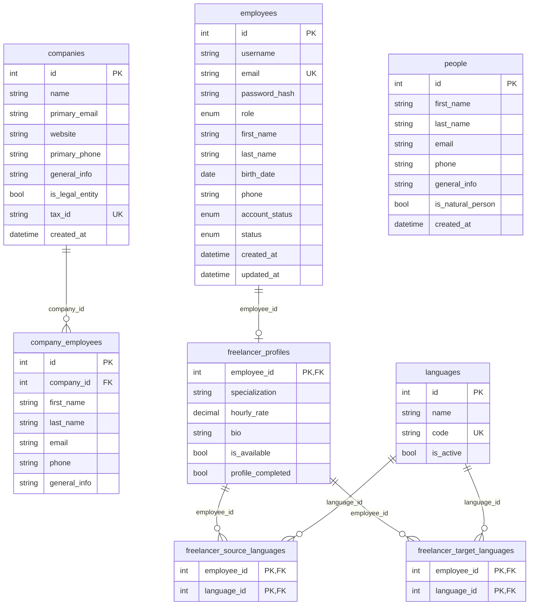
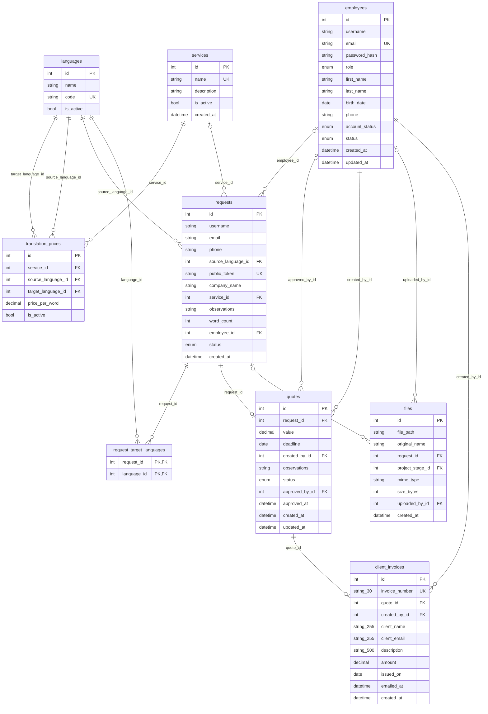
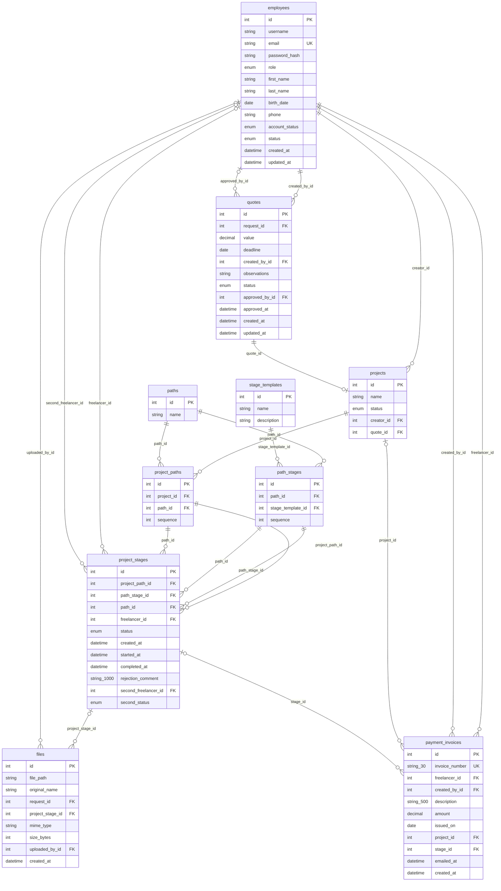
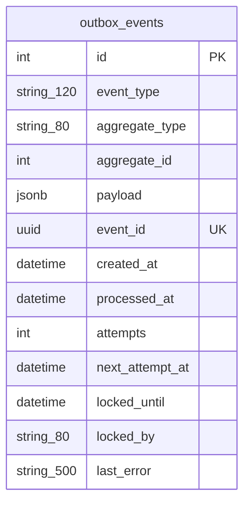

# Modelagem do Banco de Dados

Este documento descreve os dados do SoftTranslations: o banco relacional
(PostgreSQL), que guarda o negócio, e o banco de documentos (MongoDB), que
guarda a trilha de auditoria e os logs técnicos.

Os diagramas e os campos abaixo foram gerados a partir dos modelos do backend
(`backend/src/models`) e das migrations (`backend/alembic/versions`), e
conferidos com um banco criado do zero por `alembic upgrade head`.

## Sumário

- [Visão geral](#visão-geral)
- [Banco relacional (PostgreSQL)](#banco-relacional-postgresql)
  - [Pessoas, perfis e cadastros](#1-pessoas-perfis-e-cadastros)
  - [Solicitação, orçamento e fatura de venda](#2-solicitação-orçamento-e-fatura-de-venda)
  - [Projetos, etapas e fatura de pagamento](#3-projetos-etapas-e-fatura-de-pagamento)
  - [Fila de eventos (outbox)](#4-fila-de-eventos-outbox)
- [Valores dos campos de situação](#valores-dos-campos-de-situação)
- [Regras de integridade](#regras-de-integridade)
- [Banco de documentos (MongoDB)](#banco-de-documentos-mongodb)
- [Migrations](#migrations)

## Visão geral

| Banco | Tecnologia | Uso |
| --- | --- | --- |
| Relacional | PostgreSQL, acessado por SQLAlchemy 2 (assíncrono) e versionado por Alembic | Contas, solicitações, orçamentos, projetos, etapas, arquivos e faturas. |
| Documentos | MongoDB | Auditoria das ações (`audit_logs`) e logs técnicos da aplicação (`application_logs`). |

O fluxo de negócio segue esta ordem:

```text
Solicitação (requests) -> Orçamento (quotes) -> Projeto (projects)
   -> Trilhas (project_paths) -> Etapas (project_stages) -> Arquivos (files)
Orçamento aprovado -> Fatura de venda (client_invoices)
Etapa de um tradutor -> Fatura de pagamento (payment_invoices)
```

São 23 tabelas de negócio, mais a tabela `alembic_version`, que o Alembic usa
para registrar a versão do esquema.

## Banco relacional (PostgreSQL)

Legenda dos diagramas: `PK` chave primária, `FK` chave estrangeira, `UK`
valor único. Os tipos `string_N` indicam texto com limite de N caracteres.
Nas ligações, `|o--o{` indica uma relação opcional (a coluna aceita nulo).

### 1. Pessoas, perfis e cadastros



| Tabela | Finalidade |
| --- | --- |
| `employees` | Contas que entram no sistema: administrador, atendimento, gestor de projetos (`projetos`) e tradutor freelancer. O perfil vem de `role`. `account_status` indica conta ativa ou desativada e `status` indica a disponibilidade. O e-mail é único. Só o hash da senha é guardado. |
| `freelancer_profiles` | Dados extras do tradutor (especialização, valor por hora, biografia, disponibilidade e se o cadastro foi concluído). A chave é o próprio `employee_id`: cada tradutor tem no máximo um perfil. |
| `freelancer_source_languages` e `freelancer_target_languages` | Idiomas de origem e de destino em que o tradutor trabalha (relação muitos para muitos entre perfil e `languages`). São usados para filtrar candidatos na designação de etapas. |
| `languages` | Catálogo de idiomas, com código único e indicador de ativo. |
| `companies` e `company_employees` | Empresas clientes (pessoa jurídica ou não, com CNPJ/CPF único) e os contatos de cada empresa. Ao apagar a empresa, os contatos são apagados. |
| `people` | Cadastro avulso de pessoas de contato (nome, e-mail, telefone), sem vínculo direto com outras tabelas. |

### 2. Solicitação, orçamento e fatura de venda



| Tabela | Finalidade |
| --- | --- |
| `requests` | Solicitação enviada pelo formulário público: dados do cliente, idioma de origem, serviço, observações e quantidade de palavras. O `public_token` é único e dá ao cliente acesso à própria solicitação. `employee_id` é o funcionário vinculado à solicitação, quando informado. |
| `request_target_languages` | Idiomas de destino da solicitação (uma solicitação pode ter vários). |
| `services` | Catálogo de serviços (nome único, ativo ou inativo). |
| `translation_prices` | Preço por palavra para cada combinação de serviço, idioma de origem e idioma de destino. A combinação é única. |
| `quotes` | Orçamento de uma solicitação (no máximo um por solicitação): valor, prazo, observações, situação e quem o criou e o aprovou. |
| `files` | Arquivos anexados. Pertencem a uma solicitação (`request_id`) ou a uma etapa de projeto (`project_stage_id`), com nome original, tipo, tamanho e quem enviou. |
| `client_invoices` | Fatura de venda emitida ao cliente a partir do orçamento aprovado (uma por orçamento), com número único, valor, data e registro do envio por e-mail. |

### 3. Projetos, etapas e fatura de pagamento



| Tabela | Finalidade |
| --- | --- |
| `stage_templates` | Modelos reutilizáveis de etapa (por exemplo, tradução ou revisão). |
| `paths` e `path_stages` | Trilhas de workflow: uma trilha é uma sequência ordenada de modelos de etapa. `sequence` define a ordem dentro da trilha. |
| `projects` | Projeto criado a partir de um orçamento aprovado (um projeto por orçamento), com nome, situação e criador. |
| `project_paths` | Trilhas aplicadas a um projeto, com a ordem em que são executadas. |
| `project_stages` | Etapas reais do projeto. `freelancer_id` é o tradutor principal; `second_freelancer_id` e `second_status` guardam o tradutor adicional (no máximo um) e se ele apenas foi convidado ou já aceitou. `rejection_comment` guarda o motivo quando o gestor reprova a entrega. |
| `payment_invoices` | Fatura de pagamento a um tradutor, com número único, valor, data, envio por e-mail e, opcionalmente, o projeto e a etapa relacionados. |

### 4. Fila de eventos (outbox)



`outbox_events` implementa o padrão *transactional outbox*: cada ação
importante grava um evento na mesma transação que altera os dados. Um processo
em segundo plano lê os eventos pendentes e os copia para a coleção
`audit_logs` do MongoDB, com novas tentativas em caso de falha
(`attempts`, `next_attempt_at`, `locked_until`, `last_error`). Assim, uma
indisponibilidade do MongoDB não perde eventos nem impede a operação.

## Valores dos campos de situação

| Campo | Valores |
| --- | --- |
| `employees.role` | `admin`, `projetos`, `atendimento`, `freelancer` |
| `employees.account_status` | `active`, `disabled` |
| `employees.status` | `available`, `busy`, `pending` |
| `requests.status` | `pending`, `quoted`, `rejected` |
| `quotes.status` | `in_review`, `approved`, `rejected` |
| `projects.status` | `ready`, `in_progress`, `testing`, `done` |
| `project_stages.status` | `no_freelancer`, `public`, `ready`, `in_progress`, `testing`, `done` |
| `project_stages.second_status` | `invited`, `accepted` (vazio quando não há tradutor adicional) |

## Regras de integridade

- **Um para um:** uma solicitação tem no máximo um orçamento; um orçamento gera
  no máximo um projeto e uma fatura de venda.
- **Unicidade:** e-mail de funcionário, número de fatura (venda e pagamento),
  token público da solicitação, nome de serviço, código de idioma e CNPJ/CPF.
- **Ordem sem repetição:** dentro de uma trilha ou projeto, `sequence` e a
  combinação de trilha e etapa não se repetem. Cada etapa do projeto
  corresponde a uma única etapa da trilha.
- **Preços:** só existe um preço por combinação de serviço, idioma de origem e
  idioma de destino.
- **Exclusão em cascata:** ao apagar uma solicitação, seus arquivos e idiomas
  de destino são apagados; ao apagar uma empresa, seus contatos; ao apagar um
  projeto, suas trilhas e etapas; ao apagar um funcionário freelancer, seu
  perfil e idiomas.
- **Exclusão protegida (`RESTRICT`):** não é possível apagar o orçamento ou o
  funcionário que consta em uma fatura, nem o modelo de etapa ou a trilha em
  uso por um projeto.
- **Exclusão com perda de vínculo (`SET NULL`):** se o tradutor principal ou o
  adicional for apagado, a etapa permanece e o campo fica vazio; se quem enviou
  um arquivo for apagado, o arquivo permanece sem autor.
- **Tradutor adicional:** a etapa aceita no máximo um tradutor adicional,
  distinto do principal. Só o gestor convida e remove (regras aplicadas pela API, não pelo banco).

## Banco de documentos (MongoDB)

O MongoDB é opcional para iniciar o sistema: sem ele, a API funciona, os eventos
da outbox ficam pendentes e os logs técnicos não são gravados. O banco usado é
definido por `MONGODB_DATABASE` (padrão `softtranslations`).

### Coleção `audit_logs` (trilha de auditoria)

Uma linha por ação relevante, gravada pelo processo da outbox. A gravação usa
`event_id` como chave de substituição, então reprocessar um evento não o
duplica.

| Campo | Conteúdo |
| --- | --- |
| `event_id` | Identificador único do evento (o mesmo de `outbox_events.event_id`). |
| `timestamp` | Momento da ação. |
| `actor` | Quem executou (`employee_id` do funcionário) ou nulo em ações públicas. |
| `action` | Tipo da ação, no formato `entidade.acao`. |
| `entity` | `type` e `id` do registro afetado. |
| `details` | Dados específicos da ação (por exemplo, `freelancer_id`). |
| `request_id`, `correlation_id`, `source` | Rastreamento da requisição e origem (`api`). |

Ações registradas hoje: `request.created`, `request.updated`, `request.deleted`,
`request.quoted`, `request.rejected`, `request.reopened`, `request.file_added`,
`quote.created`, `quote.updated`, `quote.deleted`, `quote.approved`,
`quote.rejected`, `project.created`, `project.updated`, `project.deleted`,
`project.path_assigned`, `project_stage.created`, `project_stage.updated`,
`project_stage.completed`, `project_stage.deleted`,
`project_stage.file_added`, `project_stage.file_removed`,
`project_stage.declined`, `project_stage.collaborator_invited`,
`project_stage.collaborator_removed`, `stage_template.created`,
`path.created`, `company.created` e `person.created`.

Índices: `event_id` (único); (`entity.type`, `entity.id`, `timestamp`);
(`actor.employee_id`, `timestamp`); (`action`, `timestamp`); `timestamp`.

Além de auditoria, o evento `project_stage.declined` também é consultado pela
designação de etapas para não oferecer de novo a etapa a quem já a recusou.

### Coleção `application_logs` (logs técnicos)

| Campo | Conteúdo |
| --- | --- |
| `timestamp` | Momento do registro. |
| `level` | Nível (`INFO`, `WARNING`, `ERROR`...). |
| `logger` | Origem do log. |
| `message` | Mensagem, com valores sensíveis (senha, token, segredo, autorização) substituídos por `[REDACTED]`. |
| `request_id`, `correlation_id` | Rastreamento da requisição. |
| `exception_type` | Tipo da exceção, quando há. |
| `context` | Dados extras (objeto). |

## Migrations

O esquema é versionado com Alembic em `backend/alembic/versions`, com uma única
cabeça de migração. Para criar ou atualizar o banco:

```bash
cd backend
uv run alembic upgrade head
```

Para ver a versão atual e o histórico, use `uv run alembic current` e
`uv run alembic history`. O passo a passo de instalação está no
[Manual de Instalação](./instalation_manual.md).
