# Manual do Usuário — SoftTranslations

## Sumário

- [Sobre este manual](#sobre-este-manual)
- [Acessar o sistema](#acessar-o-sistema)
- [Navegação e permissões](#navegacao-e-permissoes)
- [Área do administrador](#area-do-administrador)
- [Área de atendimento](#area-de-atendimento)
- [Área do gestor de projetos](#area-do-gestor-de-projetos)
- [Área do tradutor](#area-do-tradutor)
- [Dicas e solução de problemas](#dicas-e-solucao-de-problemas)

## Sobre este manual

O SoftTranslations organiza solicitações de tradução e o trabalho da equipe em um só lugar. Este manual apresenta as telas e os fluxos disponíveis para clientes, atendimento, gestores, administradores e tradutores.

As imagens deste guia estão na pasta `img/` do projeto. Os menus e as ações apresentados podem variar conforme o perfil e as permissões da conta. Algumas telas podem aparecer sem registros quando ainda não há dados cadastrados.

## Acessar o sistema

1. Abra no navegador o endereço da aplicação fornecido pela equipe responsável.
2. Na página inicial, selecione **Login** ou **Fazer Login**.
3. Informe o e-mail e a senha da sua conta e selecione **Entrar**.
4. Após a autenticação, o sistema direciona você à área correspondente ao seu perfil.

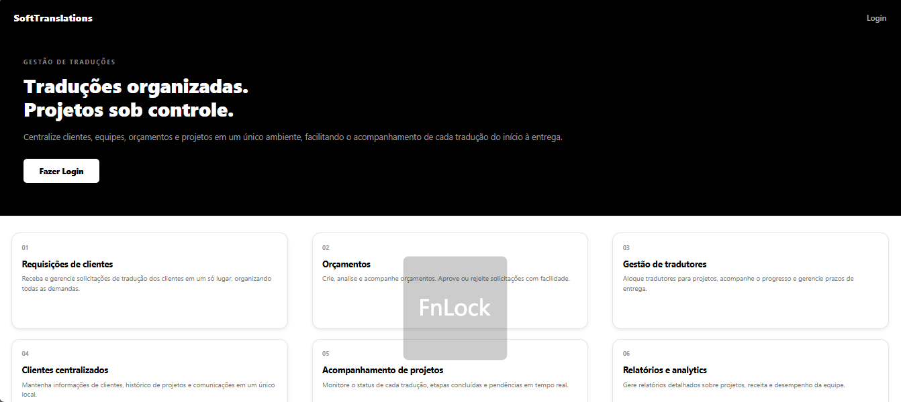

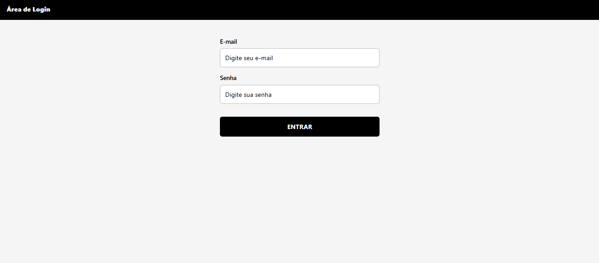

Se for seu primeiro acesso como tradutor pré-cadastrado, o sistema poderá solicitar que conclua o cadastro antes de abrir as demais telas.

## Navegação e permissões

Use o ícone de menu (☰) no cabeçalho para abrir a navegação. As opções exibidas dependem do perfil e das permissões atribuídas à conta. Se uma opção não aparecer, solicite acesso ao administrador do sistema.

Para encerrar a sessão, abra o menu e selecione **Deslogar**.

## Área do administrador

O administrador gerencia acessos e a organização dos perfis internos. No menu, abra **Gerenciar Administradores**, **Gerenciar Atendimento** ou **Gerenciar Gestores** para consultar as áreas correspondentes.

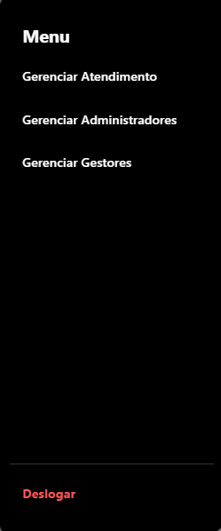

As telas de gerenciamento apresentam listas de usuários e ações de cadastro. Ao incluir ou atualizar um usuário, confira os dados e o perfil antes de salvar, pois o perfil determina quais áreas do sistema estarão disponíveis para essa pessoa.

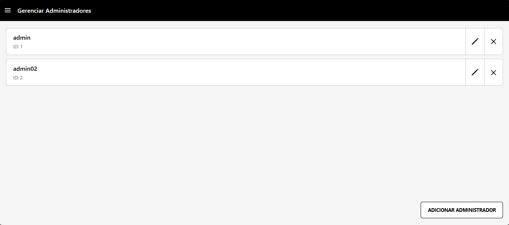

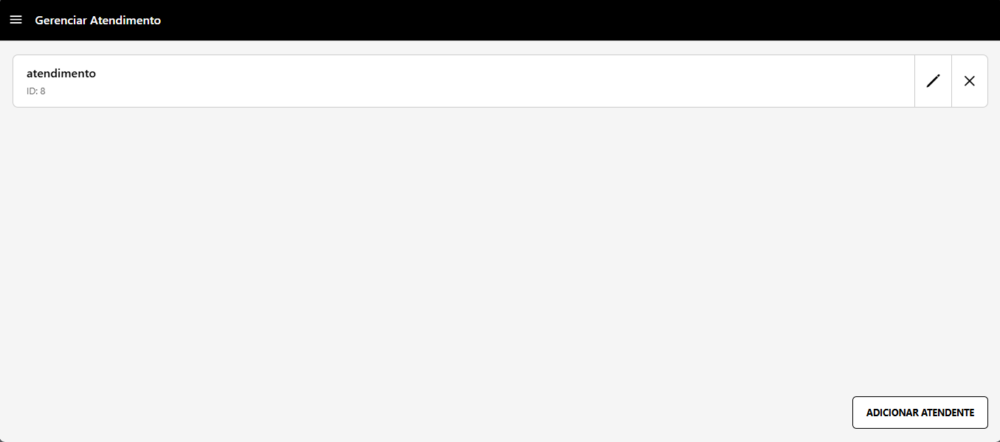

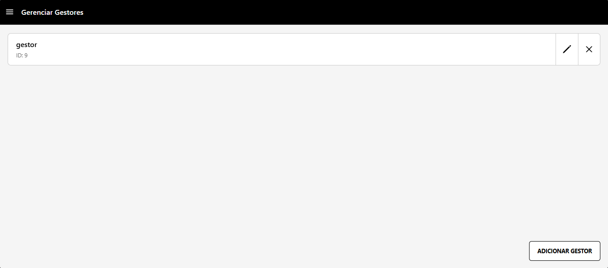

## Área de atendimento

O atendimento acompanha as solicitações recebidas e prepara orçamentos.

### Consultar solicitações

1. No menu, abra **Requisições**.
2. Selecione uma solicitação para expandir os detalhes.
3. Confira os dados de contato, o par de idiomas e as observações.
4. Se a solicitação estiver pronta para avaliação, use **Criar orçamento** para abrir o formulário associado.
5. Para remover uma solicitação, use **Excluir solicitação** e confirme a ação.

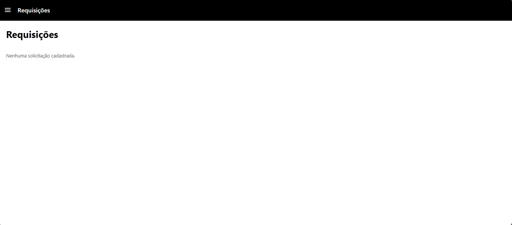

### Criar e acompanhar orçamentos

Ao criar um orçamento, revise os dados da solicitação, preencha o valor e o prazo e inclua observações quando necessário. Salve para registrar o orçamento. Na lista de orçamentos, confira cliente, serviço, idiomas, valor, prazo e situação.

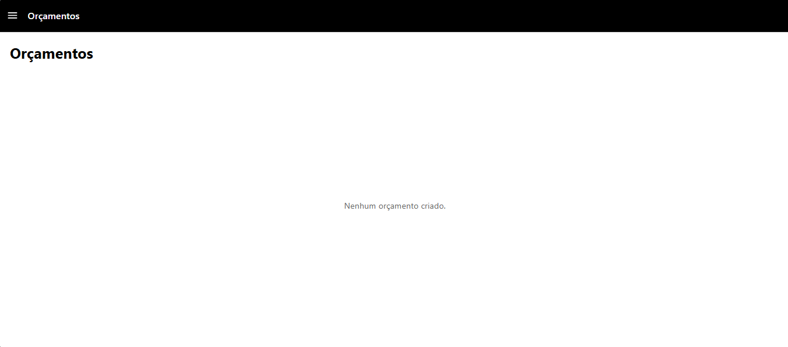

As telas podem estar vazias quando não houver solicitações ou orçamentos cadastrados. A aprovação e outras mudanças de situação dependem das ações habilitadas para o perfil.

## Área do gestor de projetos

O gestor organiza projetos, etapas, workflows e a equipe de tradutores.

### Consultar projetos

Abra **Projetos** para ver os projetos disponíveis, sua situação e a quantidade de etapas associadas. As situações exibidas podem incluir **Pronto**, **Em andamento**, **Em teste** e **Concluído**.

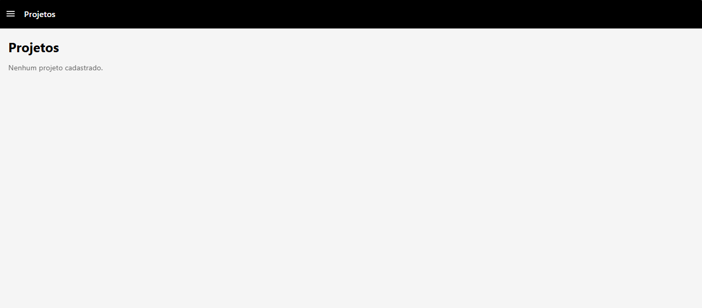

### Configurar workflows

1. Abra **Workflow** no menu do gestor.
2. Entre em **Quadros** para consultar e organizar etapas de trabalho.
3. Entre em **Trilhas** para montar sequências de etapas usando os quadros disponíveis.
4. Revise a sequência e os nomes antes de utilizá-la em um projeto.

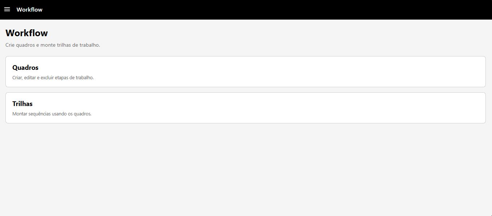

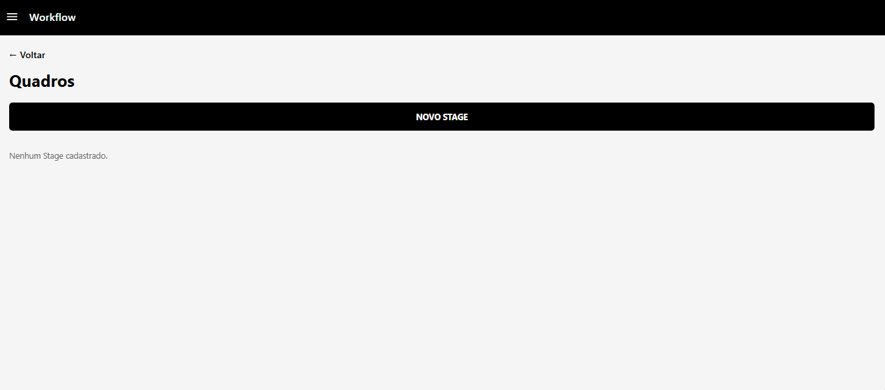

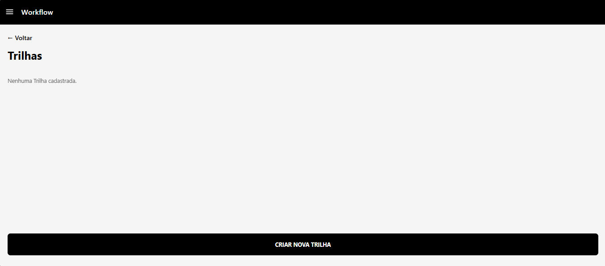

### Gerenciar tradutores e solicitações de disponibilidade

Na área **Tradutores**, consulte os profissionais cadastrados ou use a opção de pré-cadastro quando disponível. A área de solicitações permite consultar pedidos de disponibilidade relacionados aos trabalhos.

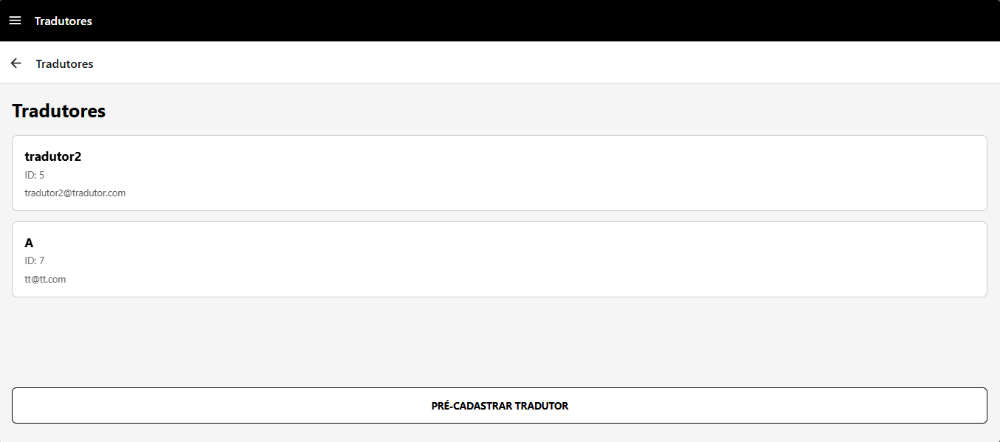

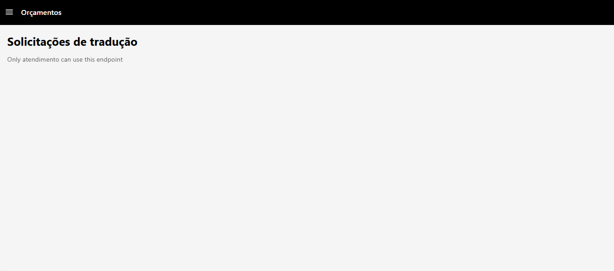

## Área do tradutor

### Concluir o cadastro

Se a conta estiver aguardando a conclusão do cadastro, informe seu nome e selecione **Concluir cadastro**. O e-mail associado à conta é exibido para conferência.

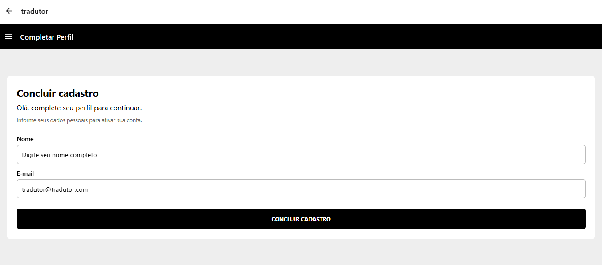

### Consultar etapas

Na área do tradutor, abra **Minhas etapas** para consultar as etapas atribuídas à sua conta e a situação de cada uma. Se a lista estiver vazia, nenhuma etapa foi atribuída ainda; entre em contato com o gestor responsável.

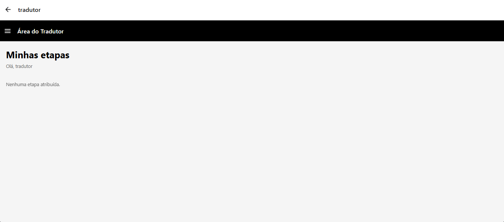

## Dicas e solução de problemas

- **Não consigo entrar:** confira se o e-mail e a senha foram digitados corretamente. Se o problema persistir, peça ao administrador para verificar seu acesso.
- **Não vejo uma opção no menu:** a opção pode não estar habilitada para seu perfil. Solicite a permissão ao administrador.
- **Uma lista está vazia:** confirme com o responsável se já existem registros ou atribuições para sua conta.
- **A página não carrega ou mostra erro de conexão:** atualize a página e tente novamente. Se continuar, avise a equipe responsável pelo sistema, informando a tela e a mensagem exibida.